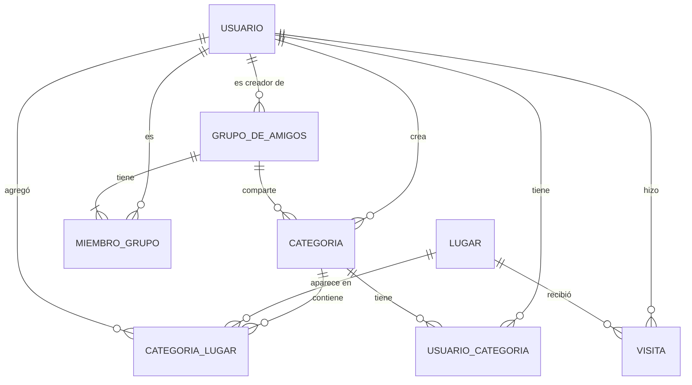

# Documento 02 · Modelo de datos

**Versión 1.0, cerrado.**

Entidades y relaciones del plan piloto de Now We Know. Incorpora todas las decisiones de la revisión. Listo para pasar a tipos y backend.

- 4 entidades
- 4 tablas intermedias

## 1. Entidades

| Entidad | Qué es |
|---|---|
| **Usuario** | Persona con cuenta. Crea categorías y grupos, y pertenece a grupos. |
| **Lugar** | Global: un café es una sola fila aunque lo guarden mil personas. Se identifica por su ID de Google Maps. |
| **Categoria** | Lo que en el alcance llamamos "carpeta": Comida, Viajes, Plan con mi novio. |
| **GrupoDeAmigos** | Personas que comparten categorías. Siempre tiene un creador y guarda su código de invitación. |

### Tablas intermedias

| Tabla | Relaciona | Qué guarda |
|---|---|---|
| **MiembroGrupo** | Usuario ↔ GrupoDeAmigos | Quién pertenece a qué grupo y desde cuándo. |
| **CategoriaLugar** | Lugar ↔ Categoria | Qué lugares hay en cada categoría y quién los agregó. |
| **UsuarioCategoria** | Usuario ↔ Categoria | Datos personales de un usuario sobre una categoría, como si la archivó. |
| **Visita** | Usuario ↔ Lugar | Qué lugares visitó cada persona. Un lugar visitado aparece como visitado en todas sus categorías. |

## 2. Relaciones

| Regla de negocio | Cardinalidad | Se resuelve con |
|---|---|---|
| Un usuario puede crear cero o muchas categorías. | Usuario 1 — 0..N Categoria | Clave foránea en Categoria |
| Una o varias personas pertenecen a un grupo; una persona puede estar en varios grupos. | Usuario N — M GrupoDeAmigos | MiembroGrupo |
| Todo grupo tiene siempre un creador. | Usuario 1 — 0..N GrupoDeAmigos | Clave foránea obligatoria en GrupoDeAmigos |
| Un grupo puede tener cero o muchas categorías. | GrupoDeAmigos 1 — 0..N Categoria | Clave foránea en Categoria |
| Un lugar puede estar en una o muchas categorías. | Lugar N — M Categoria | CategoriaLugar |
| Cada usuario archiva categorías por su cuenta. | Usuario N — M Categoria | UsuarioCategoria |
| Una categoría sin grupo es personal y solo la ve su creador. | Categoria.grupo_id nulo | Clave foránea opcional |
| Una persona puede visitar muchos lugares; un lugar puede ser visitado por muchas personas. | Usuario N — M Lugar | Visita |

## 3. Diagrama entidad-relación

## 4. Decisiones de la revisión

Todos los comentarios del code review están resueltos.

- **R2 · Grupos de amigos.** Se mantienen los grupos de amigos. CU-04 se actualizó en el documento 01: ahora se invita al grupo, no a una carpeta suelta.
- **R3 · Datos que pertenecen a una relación.** La relación se convierte en tabla propia, `UsuarioCategoria`. Su clave primaria es compuesta (usuario + categoría), así un usuario no puede tener dos filas para la misma categoría. Además de las dos claves foráneas, la tabla lleva sus propios datos, como si está archivada y desde cuándo. Es el mismo patrón que se usa en CategoriaLugar.
- **R4 + R5 · Tabla Visita.** Si visitas un lugar, queda visitado en todas tus categorías. Entonces el estado no puede vivir en Lugar (es global) ni en CategoriaLugar (habría que marcarlo en cada categoría). Es un hecho de la persona con el lugar: tabla `Visita`, usuario + lugar. Ventaja extra: CU-03 deja de recordarte un lugar en cuanto existe tu visita, sin importar en cuántas categorías esté.
- **R5 · Lugar global.** Sin duplicados del mismo café y con un identificador único de Google Maps.
- **R6 · Categorías por usuario.** Un usuario crea cero o muchas categorías.
- **R7 · Código de invitación (resuelto, con límite).** El código vive en GrupoDeAmigos. Para el piloto está bien. Así cada grupo tiene un solo código activo y no queda registro de quién lo usó. Si luego hace falta eso, el código pasa a su propia tabla.
- **R8 · Categorías personales y de grupo.** Un grupo tiene sus categorías y además cada persona puede tener categorías personales, solo visibles para ella. En la base de datos: `grupo_id` nulo = personal.
- **R9 · Visitas por persona.** Cada persona marca su visita por su lado. Además, la tabla Visita da gratis el historial de lugares visitados y la lista de pendientes de cada persona.
- **R10 · Campos.** Se mantienen `foto_url`, `google_maps_url` y `rol`. Se elimina `archivada`: basta con `archivada_en` (nulo = no archivada).

## 5. Campos

Campos acordados, sin tipos todavía.

**Convención para todas las tablas:** `id` como UUID (salvo las intermedias, que usan clave compuesta), y `creado_en` y `actualizado_en` para auditoría.

### Usuario

| Campo | Clave | Para qué |
|---|---|---|
| `id` | PK | Identificador. Lo genera el servicio de autenticación. |
| `nombre_usuario` | Único | Con el que se une a grupos (CU-04). |
| `nombre_visible` | | Cómo lo ven los demás miembros. |
| `email` | Único | Contacto y recuperación de cuenta. |
| `foto_url` | | Foto de perfil, opcional. |

No hay campo de contraseña a propósito: la contraseña la maneja el servicio de autenticación, nunca la tabla.

### Lugar (global)

| Campo | Clave | Para qué |
|---|---|---|
| `id` | PK | Identificador interno. |
| `google_place_id` | Único | Evita duplicados del mismo café (R5). |
| `nombre` | | Nombre del lugar. |
| `direccion` | | Dirección legible. |
| `latitud`, `longitud` | | Se guardan desde ya para los recordatorios por cercanía de la fase 2. |
| `imagen_url` | | Imagen del lugar (CU-01). |
| `google_maps_url` | | Para "Cómo llegar" (CU-02). |

### Categoria

| Campo | Clave | Para qué |
|---|---|---|
| `id` | PK | Identificador. |
| `nombre` | | "Comida", "Plan con mi novio". |
| `creador_id` | FK → Usuario | Quién la creó. |
| `grupo_id` | FK → Grupo, nulo | Nulo = categoría personal, solo visible para su creador. |
| `icono` | | Ícono de la categoría, también para las sugeridas. |

### GrupoDeAmigos

| Campo | Clave | Para qué |
|---|---|---|
| `id` | PK | Identificador. |
| `nombre` | | "Yo y mi novio". |
| `creador_id` | FK → Usuario, obligatorio | Siempre hay un creador. |
| `codigo_invitacion` | Único | Código para unirse (R7). |
| `codigo_expira_en` | | Para el flujo alterno de código vencido (CU-04 A1). |

### MiembroGrupo

| Campo | Clave | Para qué |
|---|---|---|
| `usuario_id` + `grupo_id` | PK compuesta, ambas FK | Un usuario está una sola vez en cada grupo. |
| `rol` | | Creador o miembro. Debe coincidir con `creador_id` del grupo. |
| `unido_en` | | Desde cuándo es miembro. |

### CategoriaLugar

| Campo | Clave | Para qué |
|---|---|---|
| `categoria_id` + `lugar_id` | PK compuesta, ambas FK | Un lugar aparece una vez por categoría. |
| `agregado_por` | FK → Usuario | Quién lo agregó. |
| `enlace_origen` | | El post de TikTok o Instagram. Va aquí y no en Lugar porque cada persona lo encontró en un post distinto. |
| `plataforma_origen` | | TikTok, Instagram o manual. |
| `agregado_en` | | Cuándo se agregó a la categoría. |

No lleva estado: lo visitado vive en la tabla Visita.

### UsuarioCategoria

| Campo | Clave | Para qué |
|---|---|---|
| `usuario_id` + `categoria_id` | PK compuesta, ambas FK | Una fila por usuario y categoría. |
| `archivada_en` | | Cuándo la archivó. Nulo = no archivada. |

### Visita

| Campo | Clave | Para qué |
|---|---|---|
| `usuario_id` + `lugar_id` | PK compuesta, ambas FK | Una visita por persona y lugar. Si existe la fila, el lugar está visitado para esa persona. |
| `visitado_en` | | Cuándo fue (CU-05). |

No hace falta un campo "estado": pendiente = no existe la fila, visitado = existe.

## 6. Siguiente paso

Modelo cerrado. Siguiente: asignar tipos a cada campo y crear las tablas en el backend.

---

Anterior: [01 · Definición y alcance](01-definicion-y-alcance.md)
